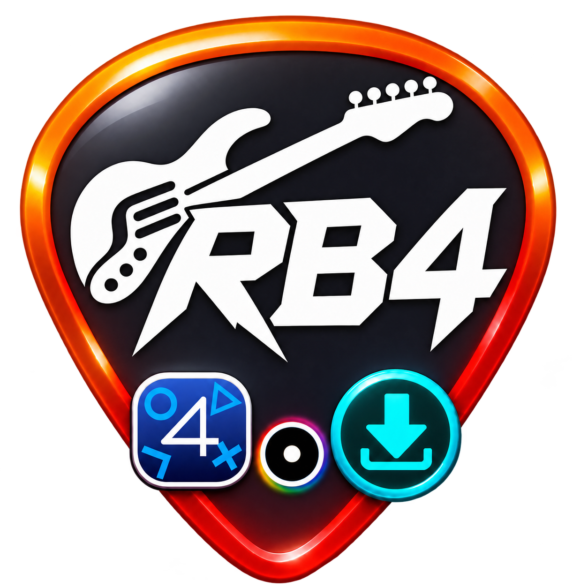
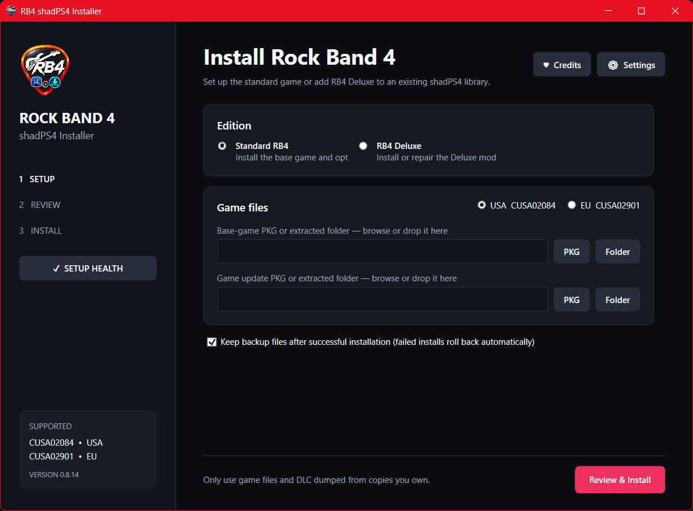
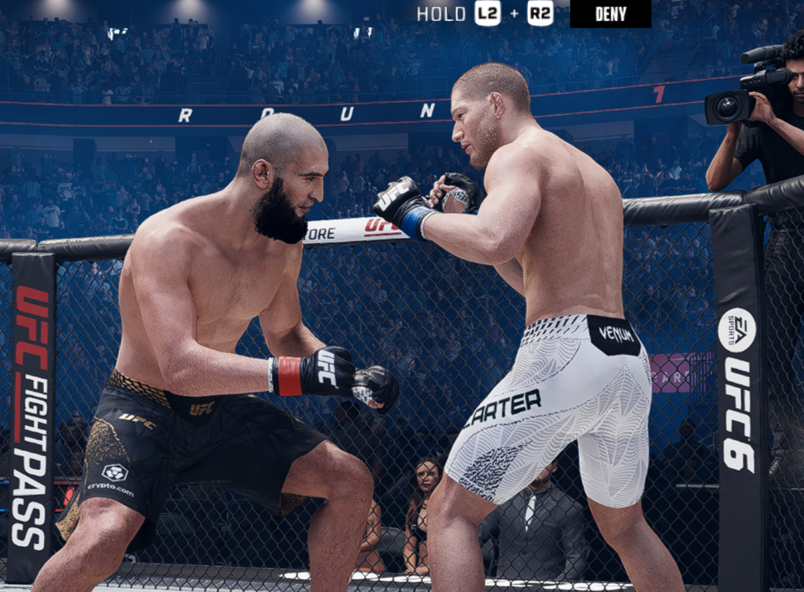
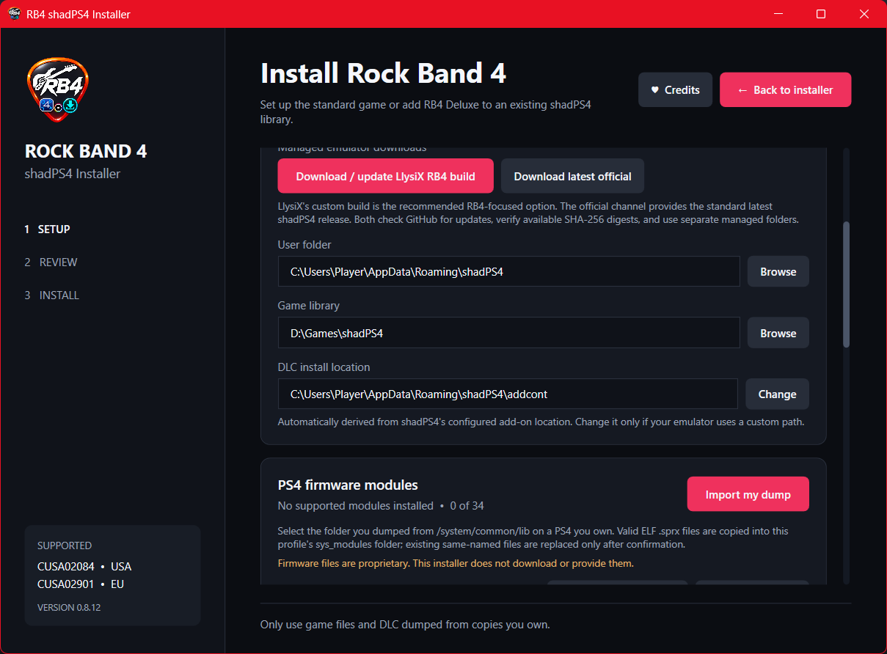
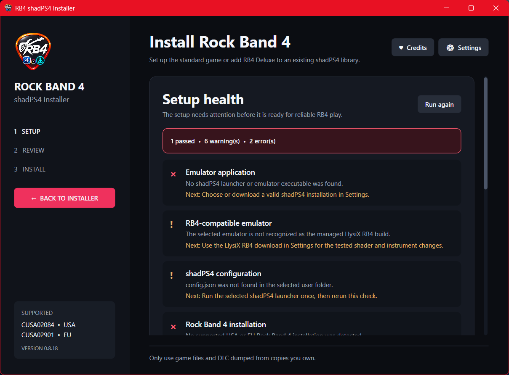
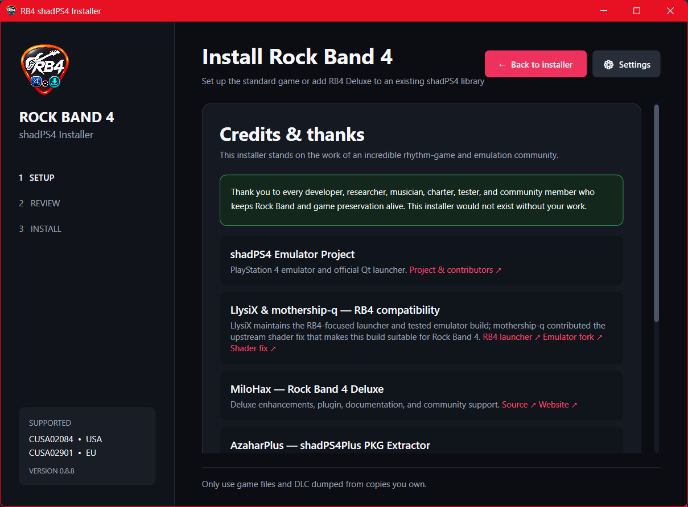
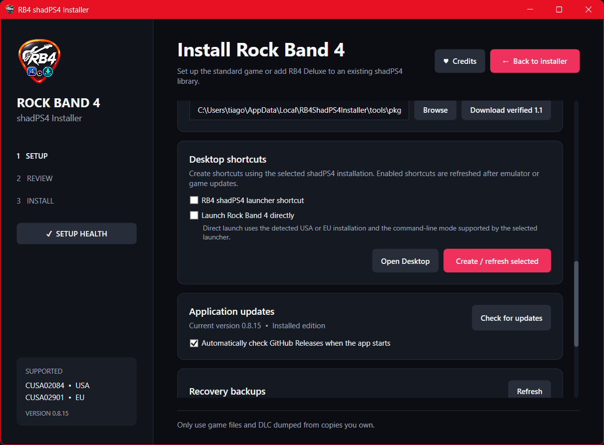
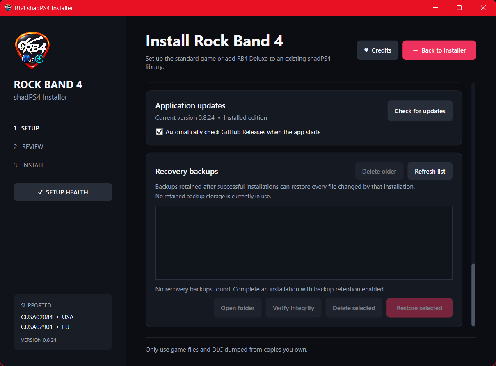

<p align="center">
  
</p>

<h1 align="center">RB4 shadPS4 Installer</h1>

<p align="center">
  Install and maintain Rock Band 4, RB4 Deluxe, updates, DLC, and custom songs for shadPS4 on Windows.
</p>

<p align="center">
  <a href="https://github.com/thyaguster/rb4-shadps4-installer/releases/latest"><strong>Download the latest release</strong></a>
  ·
  <a href="#quick-start">Quick start</a>
  ·
  <a href="https://github.com/thyaguster/rb4-shadps4-installer/wiki">Wiki</a>
  ·
  <a href="THIRD_PARTY_NOTICES.md">Credits</a>
</p>

<p align="center">
  
  
  
  
</p>



> [!IMPORTANT]
> This project does not provide Rock Band 4, updates, DLC, firmware, keys, or other copyrighted game content. Use lawful dumps made from software you own.

## What it handles

| | |
|---|---|
| **Game setup** | Base game and updates from user-provided PKGs or extracted folders |
| **RB4 Deluxe** | Download, install, detect, repair, and update |
| **Extra content** | One manager for importing, searching, auditing, catalog export, opening, and safely removing DLC/custom songs, with duplicate-import protection |
| **shadPS4** | Isolated LlysiX RB4 profile or a user-selected existing installation |
| **Firmware setup** | Validates and imports decrypted `.sprx` modules plus dumped `font` and `font2` folders from the user's own PS4 |
| **Existing installs** | Detects region, game version, Deluxe, and installed add-ons |
| **Setup health** | Runs a cancellable background check with live stage/content-scan progress for emulator/profile alignment, RB4 2.21, RB4DX, installed-content integrity, modules, fonts, disk space, and the latest launch log; exports redacted support bundles |
| **Safety** | SHA-256 checks, integrity-protected backups, conservative storage cleanup, rollback, install logs, and retained crash diagnostics |
| **Convenience** | Drag-and-drop, remembered paths, desktop shortcuts, resumable and cancellable managed downloads, and verified self-updates |

Supported game regions:

- USA — `CUSA02084`
- Europe — `CUSA02901`

## Quick start

1. Download either the **Setup** or **Portable** package from [Releases](https://github.com/thyaguster/rb4-shadps4-installer/releases/latest).
2. Select an existing shadPS4 installation, or download the recommended **LlysiX RB4 build**.
3. Choose your game library and user folder.
4. Add your own RB4 PKGs or extracted folders.
5. Review the summary and install.

Already have RB4 installed? The app detects it and opens directly in content-management mode for updates, Deluxe, DLC, and custom songs.

Custom-song imports are unlocked after RB4DX is detected. The installer keeps its mixed content queue locked on standard RB4 because it cannot reliably distinguish official DLC PKGs from custom-song PKGs before extraction. Use the **Content** button to browse installed items, queue new packages or folders, and move selected content to the Windows Recycle Bin.

Queued content is compared with the installed library. Recognized duplicates are marked and skipped by default; PKGs that can only be identified after extraction receive the same protection during installation. Enable deliberate reinstall only when repairing or replacing existing content.

The installed-content manager recognizes the standard `Custom:` and `Custom Pack` titles generated by LibForge. Other items are shown as **DLC / unclassified** because official RB4 packages and community packages can share the same publisher identifier; the installer does not guess when metadata is ambiguous.

For large DLC/custom-song collections, choose **Add PKG folder**. The installer scans the selected folder and its subfolders, then queues every `.pkg` it finds. The separate **Add extracted folder** button is only for content that has already been unpacked.

For detailed instructions, path explanations, maintenance workflows, and troubleshooting, see the [project Wiki](https://github.com/thyaguster/rb4-shadps4-installer/wiki).

## Screenshots

<table>
  <tr>
    <td width="50%"><br><strong>Managed emulator and path settings</strong></td>
    <td width="50%"><br><strong>Local firmware-module validation and import</strong></td>
  </tr>
  <tr>
    <td width="50%"><br><strong>Read-only installation health report</strong></td>
    <td width="50%"><br><strong>Credits and original-project links</strong></td>
  </tr>
  <tr>
    <td width="50%"><br><strong>Verified automatic and manual application updates</strong></td>
    <td width="50%"><br><strong>SHA-256-protected recovery backups</strong></td>
  </tr>
</table>

## Emulator choices

- **LlysiX RB4 build — recommended:** an RB4-focused shadPS4 build containing the verified shader fix. It is kept independent from other shadPS4 installations and uses a portable `user` folder beside its launcher—the working directory used by this fork. The installer checks GitHub for updates and verifies the release digest.
- **Latest official shadPS4:** the standard official Windows release, kept in a separate managed folder.

When upgrading an older installer-managed LlysiX setup, configuration, saves, keys, input profiles, sysmodules, and RB4DX data are copied into the isolated profile. Existing files under `%APPDATA%\shadPS4` are not deleted. The game library remains in its original location and is not duplicated.

The previous managed RB4 build is retained during updates so it can be recovered if necessary.

## Firmware modules

Settings includes an **Import my dump** action for decrypted `.sprx` modules dumped from `/system/common/lib` on a PS4 owned by the user. The importer validates ELF files, reports recognized and additional modules, and installs them in the active profile's `sys_modules` folder. Existing modules are preserved during managed-emulator upgrades.

The project does not download or distribute Sony firmware. Follow the [official shadPS4 dumping guide](https://github.com/shadps4-emu/shadPS4/wiki/I.-Quick-start-%5BUsers%5D#4-dumping-firmware-modules).

Settings also imports the dumped PS4 `font` and `font2` folders. Select either folder directly or a parent containing both; files are merged into the active profile without removing unrelated files. Follow the [official font dumping guide](https://github.com/shadps4-emu/shadPS4/wiki/I.-Quick-start-%5BUsers%5D#6-dumping-firmware-fonts).

If an existing shadPS4 profile configures custom `sys_modules_dir`, `font_dir`, or `addon_install_dir` values, the installer respects those active locations. Installer-managed LlysiX profiles are explicitly aligned to their isolated portable `user` folder while preserving unknown configuration keys.

## Application updates

The app checks [GitHub Releases](https://github.com/thyaguster/rb4-shadps4-installer/releases) for new versions and asks before downloading anything. Automatic checks can be disabled in Settings, and a manual **Check for updates** button remains available.

- **Setup edition:** downloads the verified Setup executable and opens it to update the installed copy.
- **Portable edition:** downloads the verified Portable ZIP. After confirmation, a hidden one-time helper closes the running executable, places and starts the new version, removes the old executable, and then removes itself.

Application updates do not replace game files or emulator binaries. Version 0.8.10 performs a one-time, non-destructive path migration for older installer-managed LlysiX profiles, including the temporary v0.8.9 layout; the original profile files remain available.

## Build from source

Requires Windows and the [.NET 8 SDK](https://dotnet.microsoft.com/download/dotnet/8.0).

```powershell
dotnet build -c Release
```

To produce the portable ZIP and Setup executable, install Inno Setup 6 and run:

```powershell
.\packaging\build-release.ps1
```

GitHub Actions builds every push. Pushing a version tag such as `v0.8.6` automatically publishes a release with the portable ZIP, Setup executable, release notes, and SHA-256 checksums.

## Credits and license

This installer builds on work by the shadPS4, LlysiX, mothership-q, MiloHax/RB4DX, AzaharPlus, LibForge, Onyx, and wider rhythm-game communities. See [Third-party notices](THIRD_PARTY_NOTICES.md) and the in-app Credits page for links and attribution.

Released under the [MIT License](LICENSE). Third-party downloads retain their own licenses and ownership.

The exact supplied PNG is preserved as `Assets/original-icon.png` and copied byte-for-byte to `Assets/app-icon.png`. The multi-resolution Windows ICO and 32px tray PNG are direct mechanical resizes of that unchanged source.
